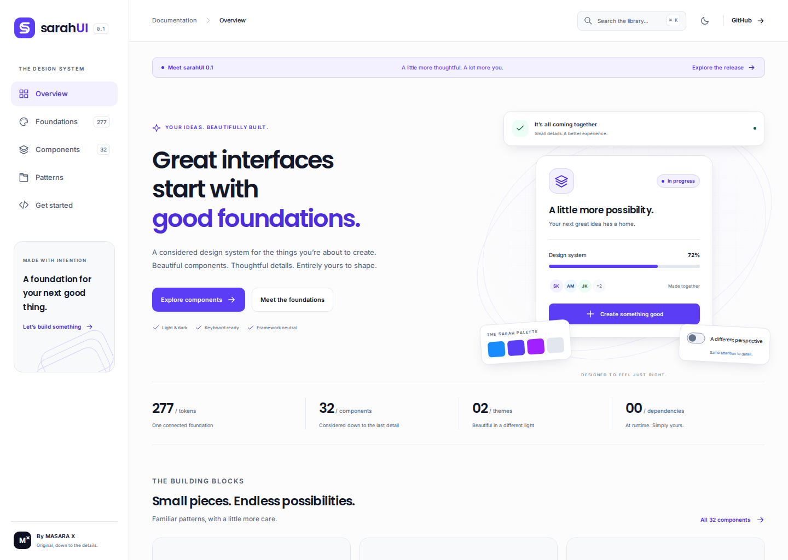

<p align="center">
  <strong>sarahUI</strong><br>
  Thoughtful by design.<br>
  <sub>An original design system and component engineering library by MASARA X</sub>
</p>

<p align="center">
  <a href="https://github.com/masarax/sarahui/actions/workflows/ci.yml"></a>
  <a href="https://www.npmjs.com/package/sarahui"></a>
  
  
  
  <a href="#accessibility"></a>
</p>

sarahUI is a foundation-first UI library for the modern web. It ships 120 framework-neutral components, 319 design tokens, light and dark themes, self-hosted fonts, and optional Tailwind integration. Everything runs on plain HTML, CSS custom properties, and ES modules with zero runtime dependencies.



<p align="center">
  <a href="docs/previews/overview-dark.png">Dark theme</a> |
  <a href="docs/previews/overview-mobile.png">Mobile</a> |
  <a href="docs/previews/components-light.png">Components</a> |
  <a href="docs/previews/foundations-light.png">Foundations</a> |
  <a href="docs/previews/patterns-light.png">Workspace pattern</a> |
  <a href="docs/previews/getting-started-light.png">Installation guide</a>
</p>

---

## Highlights

- **120 components:** every component has a dedicated entry point under `packages/ui/src/components/<ComponentName>/`, with typed props, an individual README, and unit coverage. The shared implementation lives in `packages/ui/src/templates.js`.
- **319 design tokens:** 85 primitive colors, 48 semantic roles per theme, plus layout, spacing, shape, motion, elevation, and component tokens. The token model follows Adobe Spectrum Design Data naming conventions.
- **Zero runtime dependencies:** only CSS custom properties, native browser APIs, and small progressive-enhancement modules. The package never downloads code at runtime.
- **Tailwind preset included:** `sarahui/tailwind-preset` maps colors, radii, shadows, spacing, and animations into Tailwind CSS v3 and v4.
- **Accessible by default:** WCAG 2.1 AA contrast targets, visible focus styles, WAI-ARIA patterns, keyboard navigation, and `prefers-reduced-motion` support.
- **Self-hosted typography:** Inter, Poppins, Roboto Mono, Noto Sans Bengali, and Noto Sans Arabic are bundled. No external font requests.
- **Open source:** MIT licensed, contribution-friendly, and free of vendor lock-in.

---

## Quick Start

### Install

```sh
npm install sarahui
# or
pnpm add sarahui
# or
bun add sarahui
```

### Use a component

```js
import 'sarahui/css';
import { Button, Card, render, enhanceUI } from 'sarahui';

const root = document.querySelector('#app');

root.innerHTML = render(
  Card({
    title: 'A place for your next idea',
    description: '120 modular components built for the modern web.',
    footer: Button({ label: 'Explore components', icon: 'plus' })
  })
);

// Attach interactive behavior. Returns a cleanup function.
const cleanup = enhanceUI(root);
```

Component functions return escaped markup. Compose them with the `html` tagged template and serialize with `render()`:

```js
import { html, render, Badge, Avatar } from 'sarahui';

const markup = render(html`
  <section class="s-ui">
    ${Badge({ label: 'Ready', tone: 'success' })}
    ${Avatar({ name: 'Sarah Khan', status: true })}
  </section>
`);
```

### Import styles selectively

The `sarahui/css` entry point loads fonts, tokens, and component styles in the correct order. You can also import each layer separately:

```js
import 'sarahui/fonts.css';
import 'sarahui/tokens.css';
import 'sarahui/styles.css';
```

### Import a single component

```js
import { Marquee } from 'sarahui/components/Marquee';
```

Barrel imports from `sarahui` remain the simplest option. Modern bundlers tree-shake unused exports.

---

## Tailwind CSS Integration

The preset maps sarahUI tokens into Tailwind utilities without replacing your existing scales.

```js
// tailwind.config.js
import sarahuiPreset from 'sarahui/tailwind-preset';

export default {
  presets: [sarahuiPreset],
  content: [
    './src/**/*.{html,js,ts,jsx,tsx}',
    './node_modules/sarahui/src/**/*.{js,css}'
  ]
};
```

```html
<div class="bg-sarah-surface border border-sarah-border rounded-sarah-xl p-s-24 shadow-s-raised">
  <h2 class="text-sarah-primary text-xl font-semibold">Token-driven card</h2>
  <p class="text-sarah-secondary mt-s-8">Styled with shared design tokens.</p>
  <button type="button" class="s-button s-button--primary s-button--md">
    <span>Action</span>
  </button>
</div>
```

CommonJS consumers can use `require('sarahui/tailwind-preset')`.

---

## Framework Integration

sarahUI is framework-neutral. Render the markup with any tool and call `enhanceUI()` after the markup is in the DOM.

### React / Next.js

```jsx
import 'sarahui/css';
import { useEffect, useRef } from 'react';
import { enhanceUI } from 'sarahui';

export function Showcase() {
  const containerRef = useRef(null);

  useEffect(() => {
    if (containerRef.current) {
      return enhanceUI(containerRef.current);
    }
  }, []);

  return (
    <main ref={containerRef} className="s-ui min-h-screen p-8 bg-sarah-canvas">
      <div className="s-marquee" data-direction="left" data-speed="30">
        <div className="s-marquee-track">
          <span className="px-4 text-sarah-primary">120 Components</span>
          <span className="px-4 text-sarah-brand">Zero Dependencies</span>
        </div>
      </div>
    </main>
  );
}
```

### Vue 3 / Nuxt

```vue
<script setup>
import 'sarahui/css';
import { ref, onMounted, onBeforeUnmount } from 'vue';
import { enhanceUI } from 'sarahui';

const root = ref(null);
let cleanup = () => {};

onMounted(() => {
  if (root.value) cleanup = enhanceUI(root.value);
});
onBeforeUnmount(() => cleanup());
</script>

<template>
  <main ref="root" class="s-ui">
    <div class="s-bento-grid"><!-- BentoGrid cells --></div>
  </main>
</template>
```

### Laravel with Vite

```js
// resources/js/app.js
import 'sarahui/css';
import { enhanceUI } from 'sarahui';

document.addEventListener('DOMContentLoaded', () => {
  enhanceUI(document);
});
```

---

## Component Inventory

| Category | Count | Components |
|---|---|---|
| **Components** | 16 | `Marquee`, `Terminal`, `HeroVideoDialog`, `BentoGrid`, `AnimatedList`, `Dock`, `Globe`, `TweetCard`, `OrbitingCircles`, `AvatarCircles`, `IconCloud`, `Lens`, `Pointer`, `SmoothCursor`, `ProgressiveBlur`, `DottedMap` |
| **Special Effects** | 9 | `AnimatedBeam`, `BorderBeam`, `ShineBorder`, `MagicCard`, `GlareHover`, `Meteors`, `Confetti`, `Particles`, `AnimatedThemeToggler` |
| **Animations** | 1 | `BlurFade` |
| **Text Animations** | 18 | `TextAnimate`, `TypingAnimation`, `LineShadowText`, `AuroraText`, `VideoText`, `NumberTicker`, `AnimatedShinyText`, `AnimatedGradientText`, `TextReveal`, `DiaTextReveal`, `HyperText`, `WordRotate`, `ScrollBasedVelocity`, `SparklesText`, `MorphingText`, `SpinningText`, `Highlighter`, `Text3DFlip` |
| **Device Mocks** | 3 | `Safari`, `Iphone`, `Android` |
| **Buttons** | 3 | `RainbowButton`, `ShimmerButton`, `RippleButton` |
| **Backgrounds** | 12 | `FlickeringGrid`, `AnimatedGridPattern`, `RetroGrid`, `Ripple`, `DotPattern`, `GridPattern`, `HexagonPattern`, `StripedPattern`, `InteractiveGridPattern`, `LightRays`, `NoiseTexture`, `Floating3DParticles` |
| **Community** | 16 | `ShinyButton`, `FileTree`, `CodeComparison`, `ScrollProgress`, `NeonGradientCard`, `ComicText`, `KineticText`, `CoolMode`, `PixelImage`, `PulsatingButton`, `WarpBackground`, `InteractiveHoverButton`, `AnimatedCircularProgressBar`, `Backlight`, `GlyphMatrix`, `AnimatedSubscribeButton` |
| **Forms & Inputs** | 7 | `Input`, `Textarea`, `Select`, `Checkbox`, `Radio`, `Switch`, `Slider` |
| **Navigation** | 6 | `Tabs`, `Breadcrumb`, `Pagination`, `NavItem`, `Menu`, `CommandPalette` |
| **Feedback & Overlays** | 9 | `Alert`, `Dialog`, `Tooltip`, `Toast`, `Drawer`, `Popover`, `Sheet`, `ContextMenu`, `HoverCard` |
| **Layout & Display** | 20 | `Icon`, `Button`, `IconButton`, `ButtonGroup`, `Badge`, `Chip`, `Avatar`, `Card`, `DataTable`, `Accordion`, `Progress`, `Skeleton`, `EmptyState`, `Separator`, `Spinner`, `Toggle`, `ToggleGroup`, `Kbd`, `AspectRatio`, `Collapsible` |

Full component reference: [`docs/components.md`](docs/components.md).

---

## Design Tokens

Tokens are defined once in `tokens/sarah.tokens.json` and compiled into CSS variables, TypeScript declarations, and JSON.

```
tokens/sarah.tokens.json (319 tokens)
├── 1. Primitives (85)          # Raw colors across 8 scales
├── 2. Semantic Roles (48/mode) # canvas, surface, action-primary, status-success, ...
└── 3. Component Tokens (54)    # marquee/duration, terminal/bg, bento/radius, ...
```

Each component token follows the Spectrum flat-name object format:

```json
{
  "property": "border-radius",
  "component": "magic-card",
  "structure": "surface",
  "intent": "neutral",
  "state": "idle",
  "colorScheme": "any",
  "scale": "desktop"
}
```

Compiled output is written to `packages/ui/src/tokens.css` and `tokens/generated/`:

```css
:root {
  --s-marquee-duration: var(--s-duration-slow);
  --s-marquee-gap: var(--s-spacing-16);
  --s-terminal-radius: var(--s-radius-xl);
  --s-terminal-bg: var(--s-bg-surface);
  --s-bento-radius: var(--s-radius-xl);
  --s-dock-radius: var(--s-radius-full);
}
```

### Theming API

```js
import { setTheme } from 'sarahui';

// Sets data-theme and data-theme-preference, then emits 'sarah:themechange'.
setTheme('dark'); // 'light' | 'dark' | 'system'
```

---

## Accessibility

- **WCAG 2.1 AA:** text contrast is tested at 4.5:1 or higher in both themes; UI boundaries and focus rings stay at 3:1 or higher.
- **WAI-ARIA patterns:** components expose semantic roles, accessible names, and polite live regions where content changes.
- **Keyboard support:** composite widgets such as `Dock`, `Tabs`, and `CommandPalette` implement roving `tabindex` and arrow-key navigation.
- **Reduced motion:** continuous animations collapse to static layouts or zero-duration transitions when `prefers-reduced-motion: reduce` is active.

See [`docs/accessibility.md`](docs/accessibility.md) for the full conformance notes.

---

## Development

Requirements: **Node.js 22+**.

```sh
# Clone the repository
git clone https://github.com/masarax/sarahui.git
cd sarahui

# Install development tooling (Playwright and TypeScript)
npm install

# Rebuild tokens, package files, and the documentation site
npm run build

# Start the documentation server (prints the local address)
npm run dev

# Recompile design tokens from tokens/sarah.tokens.json
npm run tokens

# Run the unit, DOM, and security test suites
npm test

# Build and run every check
npm run check
```

### Test suites

```sh
npm test                 # Unit, DOM, token, registry, and security tests
npm run test:browser     # Playwright browser verification (requires a build)
npm run test:package     # Pack the npm tarball and verify a clean install
```

---

## Project Structure

```
sarahui/
├── packages/ui/
│   ├── src/
│   │   ├── components/         # 120 per-component entry points
│   │   │   ├── Marquee/        # index.js, Marquee.js, Marquee.d.ts, README.md
│   │   │   └── index.js        # Barrel export for every component
│   │   ├── styles/             # Mirror of the canonical stylesheets
│   │   ├── tokens/             # Generated token modules
│   │   ├── utilities/          # html, raw, render, attributes, enhancers
│   │   ├── templates.js        # Shared component implementations
│   │   ├── index.js            # Public API and enhanceUI()
│   │   ├── styles.css          # Component styles
│   │   ├── tokens.css          # Generated CSS variables
│   │   ├── fonts.css           # Self-hosted font faces
│   │   ├── sarahui.css         # Canonical style entry point
│   │   └── tailwind-preset.js  # Tailwind CSS preset
│   ├── assets/fonts/           # Bundled WOFF files and OFL notices
│   └── package.json            # Unscoped "sarahui" npm package
├── apps/docs/                  # Interactive documentation application
├── tokens/
│   ├── sarah.tokens.json       # Source of truth for all tokens
│   └── generated/              # Compiled CSS, TypeScript, and JSON
├── scripts/                    # Build, token, and package tooling
├── tests/                      # Unit, DOM, browser, and adversarial suites
└── docs/                       # Guides, previews, and accessibility notes
```

---

## Contributing

Contributions are welcome. Read [`CONTRIBUTING.md`](CONTRIBUTING.md) for local setup, coding conventions, and the pull-request checklist.

- Report bugs and request features through GitHub Issues.
- Keep changes focused and include tests for behavior changes.
- Run `npm run check` before opening a pull request.

---

## License & Credits

- Library code: [MIT License](LICENSE).
- Fonts: Inter, Poppins, Roboto Mono, Noto Sans Bengali, and Noto Sans Arabic, each under the SIL Open Font License. See [`THIRD_PARTY_NOTICES.md`](THIRD_PARTY_NOTICES.md).
- Design and engineering: MASARA X.
